
<a href="https://canessasyslabs.com"></a>

<b>A CV flattens judgment into job titles. This shows the work the way a product is shown: purpose, process, proof and honest status, on one link.</b>

<a href="https://canessasyslabs.com"><b>See it live&nbsp;&nbsp;→</b></a>&nbsp;&nbsp;·&nbsp;&nbsp;<a href="#see-it-in-motion">Tour</a>&nbsp;&nbsp;·&nbsp;&nbsp;<a href="#watch-the-stories">Films</a>&nbsp;&nbsp;·&nbsp;&nbsp;<a href="#how-it-works">How it works</a>&nbsp;&nbsp;·&nbsp;&nbsp;<a href="#your-own-edition">Your own edition</a>


<a href="https://canessasyslabs.com"></a>


A CV flattens years of judgment into job titles. A social profile buries work in a feed. A gallery site shows finished outputs but not how they were reached, or whether they're finished at all. None of them answers what a client, an employer or a partner actually asks: **is this the person, and the approach, I want on a hard problem?**

A digital career portfolio answers that by showing the work the way a product is shown: purpose, process, proof and honest status.

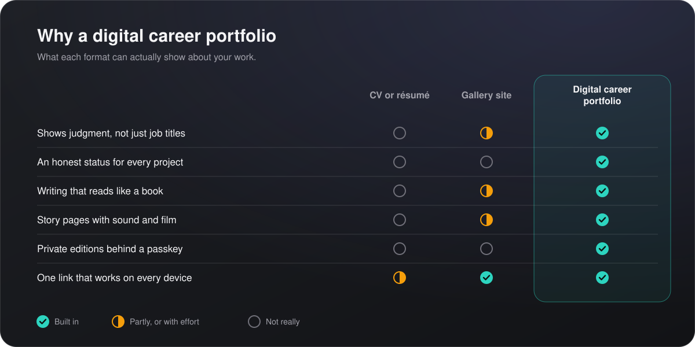


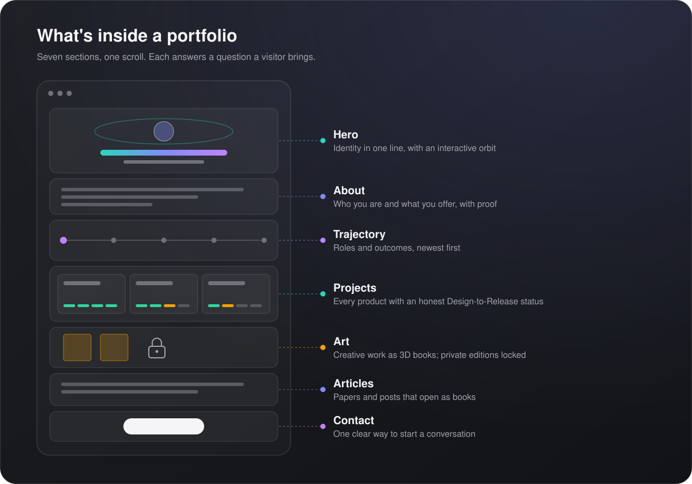

| A visitor wants to know | The section that answers |
|---|---|
| Who is this, in one line? | **Hero**: identity and positioning, with an interactive orbit that invites exploring |
| What do they offer, and is there proof? | **About**: story, offers with evidence, skills and certifications |
| Where have they been? | **Trajectory**: roles and outcomes, newest first, without naming employers |
| What have they built, and is it real? | **Projects**: each product with its purpose, process figures and development status |
| How do they think? | **Articles**: papers and posts that open as books |
| What else do they make? | **Art**: creative work as 3D books, with private editions behind a passkey |
| How do I reach them? | **Contact**: one clear next step |



**Status you can trust.** Every project carries a Design → Build → Test → Release ladder, and the build refuses a claim that runs ahead of the evidence.

**Built for the device in your visitor's hand.**

- **Books, not PDFs.** Papers and art open as page-turning 3D books. There are no downloads to lose control of.
- **Private editions.** Selected work sits behind a passkey, served only from the owner's host.
- **Every screen size.** Checked from 320 px phones to wide desktops, in light and dark themes.
- **Accessible motion.** Animation pauses on request and respects reduced-motion settings, and spoken audio has captions.
- **Fast and owned.** A static site with no backend, no tracking stack and no platform lock-in.


<a href="https://canessasyslabs.com/cetus/"></a>

<a href="https://canessasyslabs.com/cetus/"></a>

A product page can become a story: chapters, motion, recorded voice, sound and film. Each card opens its page on canessasyslabs.com.

All words and status live in one content file. One Python script turns it into a finished static site. Every change goes to a private preview link first; a deliberate publish puts it live, behind a guard that protects the private editions.

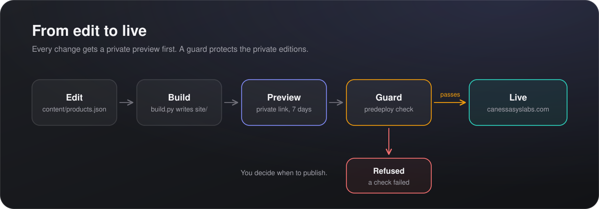

<b>What counts as evidence</b>

- **The status ladders are enforced by the build**, not typed by hand and hoped for.
- **Project figures come from each project's own records** (tests passed, skills packaged), and the copy states what remains open.
- **Private editions never enter this repository.** They exist only on the canonical host, and a deploy that would drop them is refused.
- **A portfolio presents work; it doesn't certify it.** Each product's own documentation carries its evidence.

<a href="https://canessasyslabs.com/#contact"></a>

<a href="https://canessasyslabs.com"></a>

© Canessa System Labs. All rights reserved. This repository presents the work; it does not license it. No part of its text, images or design may be reused without written permission.

